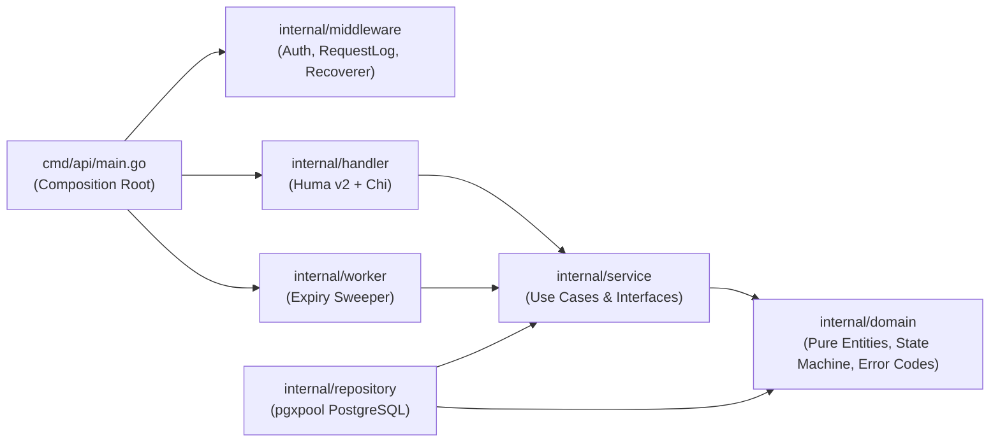
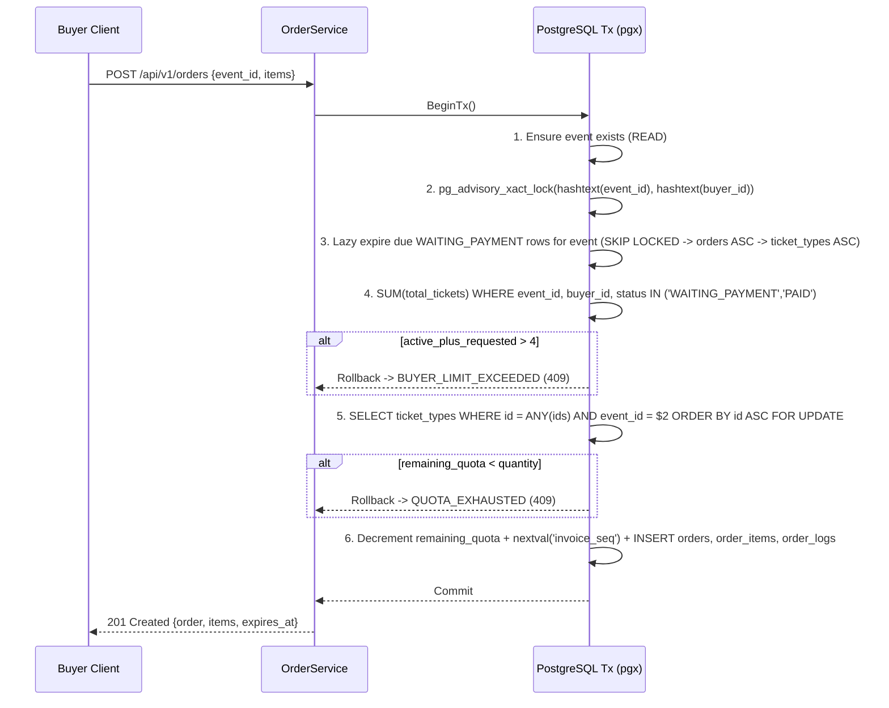

# Technical Specification: Treean API

> **Feature ID:** `treean`
> **Product Spec:** [`PRODUCT.md`](./PRODUCT.md)
> **Design Spec:** [`2026-11-15-event-ticketing-design.md`](../../docs/superpowers/specs/2026-11-15-event-ticketing-design.md)
> **Decision Records:** [`DECISIONS.md`](../../DECISIONS.md)
> **Go Module:** `github.com/torikh42/treean` (`go1.26.2`)

---

## 1. Context & Architectural Boundaries

This repository builds a standalone PostgreSQL-backed REST API in Go for high-concurrency limited-quota event ticketing. User-visible behavior, state transitions, and invariants `B1` through `B10` are defined in [`PRODUCT.md`](./PRODUCT.md).

Design patterns adapt proven mechanics inspected across the user's prior codebases:
- Explicit lock ordering (`ORDER BY id ASC FOR UPDATE`) and batch background expiry cleanup (`siera` merch checkout and expiry sweeper).
- SHA-512 webhook signature verification and per-transaction audit logging (`RentSafe-ai` Midtrans webhook handler).
- Fail-closed webhook authentication, audit logs persisted outside rollback boundaries, status transition `order_logs`, and machine-readable domain error codes (`SERA_ACV_ServiceDoku` and `SERA_ACV_ServiceOrder`).

Unlike `SERA_ACV_ServiceDoku`'s *"PAID Always Wins"* policy (appropriate for non-quota vehicle inspections), limited-quota ticketing enforces **Quota Safety First**: expired orders release their reservation and never issue tickets on late payment capture.

---

## 2. Architecture Diagram & Concurrency Flow

### 2.1 Dependency Graph (`Clean Layered + DDD-Lite`)

### 2.2 Multi-Item Checkout Lock Ordering (`POST /api/v1/orders`)

---

## 3. Proposed Changes & File Ownership

### 3.1 Configuration & Bootstrap (`internal/config`, `cmd/api`)
- `internal/config/config.go`: Loads and validates `PORT`, `DATABASE_URL`, `JWT_SECRET`, `WEBHOOK_SECRET`, `ALLOW_DEMO_HEADER_AUTH`, `EXPIRY_SWEEP_INTERVAL`, and `HTTP_READ_TIMEOUT` / `HTTP_WRITE_TIMEOUT`.
- `cmd/api/main.go`: Initializes `slog` JSON logger, creates `pgxpool.Pool` (explicit `MaxConns`, `MinConns`, `MaxConnLifetime`, `MaxConnIdleTime`), runs versioned SQL migrations (`migrations/*.sql`), starts `worker.ExpirySweeper` under root `signal.NotifyContext`, wires services/handlers/middlewares into Chi + Huma v2, and drains HTTP + worker goroutines gracefully on `SIGINT`/`SIGTERM`.

### 3.2 Pure Domain Core (`internal/domain`)
Contains zero database, HTTP, or framework imports:
- `internal/domain/errors.go`: Implements `DomainError` (`Code`, `HTTPStatus`, `Message`, `Details`) plus sentinel constructors (`NewQuotaExhaustedError`, `NewBuyerLimitExceededError`, `NewOrderExpiredError`, `NewPaymentAmountMismatchError`, `NewUnauthorizedWebhookError`, etc.) and implements `huma.StatusError` or translates cleanly at the handler boundary so HTTP mapping is centralized.
  - Note: Keep `internal/domain` free of `huma` imports too! Map `*domain.DomainError` to `huma.StatusError` inside `internal/handler/error_mapper.go`.
- `internal/domain/user.go`: `Role` (`RoleOrganizer`, `RoleBuyer`), `User`, `Actor`.
- `internal/domain/event.go`: `Event`, `TicketType` (with `Validate()` enforcing `price_idr >= 0` and `total_quota > 0`).
- `internal/domain/order.go`: `OrderStatus` (`WAITING_PAYMENT`, `PAID`, `CANCELLED`, `EXPIRED`), `MaxTicketsPerBuyerPerEvent = 4`, `OrderHoldDuration = 15 * time.Minute`, `Order`, `OrderItem`, `OrderLog`, pure transition guards `(o *Order) CanPay(now time.Time) error` and `(o *Order) CanCancel(now time.Time) error`.
- `internal/domain/ticket.go`: `Ticket`, `PaymentWebhook`, `WebhookOutcome` constants (`PROCESSED_PAID`, `IGNORED_DUPLICATE`, `REJECTED_LATE_EXPIRED`, `PROCESSED_FAILED`, `AMOUNT_MISMATCH`, `SIGNATURE_INVALID`, `ORDER_NOT_FOUND`, `IGNORED_UNKNOWN_EVENT`), and pure `ComputeSHA512Signature` / `VerifySHA512Signature` (`hmac.Equal`).

### 3.3 Service Layer & Consumer Interfaces (`internal/service`)
- `internal/service/interfaces.go`: Consumer-defined interfaces (`UserRepository`, `EventRepository`, `OrderRepository`, `WebhookRepository`).
- `internal/service/auth_service.go`: Registration (`bcrypt` cost 12, unique email -> `EMAIL_ALREADY_EXISTS`), Login (JWT HS256 with `sub`, `email`, `role`, `exp`), and `EnsureDemoUser` when `ALLOW_DEMO_HEADER_AUTH=true`.
- `internal/service/event_service.go`: `CreateEvent` (validates `ORGANIZER` role, min 2 ticket types, unique tier names inside event), `ListEvents` & `GetEvent` (calls `orderRepo.ExpireDueOrdersByEvent` / `ExpireDueOrdersBatch` when partial index sees due rows before returning live quota).
- `internal/service/order_service.go`: `CreateOrder`, `CancelOrder`, `ListOrders`, `GetOrder` (ownership enforced: only `order.BuyerID == actor.ID` unless `ORGANIZER` owns the event).
- `internal/service/payment_service.go`:
  - `ProcessWebhook(ctx, WebhookInput)`:
    1. Rejects empty configured `WEBHOOK_SECRET` or mismatched constant-time SHA-512 signature (`401 UNAUTHORIZED_WEBHOOK`), logging `SIGNATURE_INVALID` to `payment_webhooks` outside any rollback transaction.
    2. Persists audit log on completion/failure outside the business transaction.
    3. Ignores unrecognized `transaction_status`? Handles `"settlement"` / `"capture"` (success), `"deny"` / `"cancel"` / `"expire"` (failure), and unknown statuses (`IGNORED_UNKNOWN_EVENT` -> `200 OK`).
    4. Delegates atomic payment state transition to `orderRepo.ConfirmPayment` / `orderRepo.FailPayment`.
  - `PayOrderForDemo(ctx, actor, orderID)`: Loads order, verifies ownership, constructs canonical signed webhook payload server-side, and executes `ProcessWebhook`.
- `internal/service/demo_service.go`: `RunFlashSale(ctx, eventID, ticketTypeID, requests int)` spawns `requests` (default `200`) concurrent goroutines synchronized behind a `close(startGate)` barrier so all bookings hit `OrderService.CreateOrder` simultaneously, then aggregates counts and verifies final DB remaining quota == `0` (when `requests >= quota`).

### 3.4 PostgreSQL Repository & Migrations (`migrations/`, `internal/repository`)
- `migrations/001_init_schema.sql`:
  - Tables: `users`, `events`, `ticket_types`, `orders`, `order_items`, `order_logs`, `tickets`, `payment_webhooks`.
  - Sequence: `CREATE SEQUENCE IF NOT EXISTS invoice_seq START 1;`
  - Check constraints:
    - `ticket_types`: `CHECK (price_idr >= 0)`, `CHECK (total_quota > 0)`, `CHECK (remaining_quota >= 0 AND remaining_quota <= total_quota)`
    - `orders`: `CHECK (total_tickets BETWEEN 1 AND 4)`, `CHECK (total_amount_idr >= 0)`, `CHECK (status IN ('WAITING_PAYMENT','PAID','CANCELLED','EXPIRED'))`
    - `order_items`: `CHECK (quantity > 0)`
  - Uniqueness & Indexes:
    - `UNIQUE (event_id, name)` on `ticket_types`
    - `UNIQUE (order_item_id, seat_sequence)` and `UNIQUE (ticket_code)` on `tickets`
    - Partial expiry index: `CREATE INDEX idx_orders_active_expiry ON orders (event_id, expires_at) WHERE status = 'WAITING_PAYMENT'`
    - Buyer allowance index: `CREATE INDEX idx_orders_buyer_event_status ON orders (event_id, buyer_id, status)`
- `migrations/002_seed_demo.sql`:
  - Deterministic UUIDs using `INSERT ... ON CONFLICT DO NOTHING` for 1 organizer (`organizer@event.local`), 2 sample buyers (`buyer1@event.local`, `buyer2@event.local`), and 1 ready-to-demo event (`Tech Flash Concert 2026`) with `Reguler` (`80` quota, `150000` IDR) and `VIP` (`20` quota, `350000` IDR) totaling `100` tickets.
- `internal/repository/migrator.go`: Acquires `pg_advisory_lock`, applies unapplied `*.sql` files in lexical order, and records versions in `schema_migrations`.
- `internal/repository/order_repo.go`:
  - Enforces universal deadlock-free lock order:
    - Allocation path (`CreateOrder`): `advisory_xact_lock(event, buyer)` -> lazy expire (`orders ASC SKIP LOCKED` -> `ticket_types ASC`) -> `ticket_types ASC FOR UPDATE`.
    - Release/settlement path (`CancelOrder`, `ConfirmPayment`, `ExpireDueOrdersBatch`): `orders (id ASC) FOR UPDATE` -> `ticket_types (id ASC) FOR UPDATE` (when returning quota).

### 3.5 HTTP Transport, OpenAPI, & Middleware (`internal/handler`, `internal/middleware`, `web/`)
- `internal/handler/router.go`:
  - Configures `chi.NewRouter()` with `chiMiddleware.RequestID`, `chiMiddleware.RealIP`, custom `slog` HTTP logger, `middleware.Recoverer` (returns JSON 500 on panic), and `chiMiddleware.Timeout(30 * time.Second)`.
  - Configures `huma.DefaultConfig("Event Ticketing API", "1.0.0")` with `config.DocsRenderer = huma.DocsRendererScalar`, `bearer` OpenAPI security scheme, and `/docs` + `/openapi.json` routes.
  - Mounts `GET /health` (pings DB `pool.Ping` and returns `200`/`503`) and `GET /demo` (serves embedded `web/demo.html`).
  - Note on `web/demo.html`: Visual styling and interactive layout for `web/demo.html` remain gated until the user confirms `antislop` mode (`during` vs `after`) and provides or approves a `DESIGN.md` direction. Until then, only the Go route scaffold (`embed.FS`) is finalized in the technical plan.

---

## 4. Testing & Validation Matrix (Mapped to `PRODUCT.md` `B1`..`B10`)

| Invariant | Verification Type | Test Case / Command | Expected Result |
| :--- | :--- | :--- | :--- |
| **B1** | Unit + Integration | `TestEventService_CreateValidation` (`internal/service`), `TestIntegration_EventCreateAndList` (`tests/`) | Non-organizer -> `403`; `<2` tiers -> `422`; valid request persists event + tiers atomically. |
| **B2** | Integration | `TestIntegration_RealTimeQuotaAfterExpiry` (`tests/`) | Backdating `expires_at` then calling `GET /api/v1/events/{id}` immediately reflects restored `remaining_quota`. |
| **B3** | Unit + Integration | `TestIntegration_OrderCreateAndHold15Min` (`tests/`) | Creates `WAITING_PAYMENT` order with `expires_at = created_at + 15m`, decrements quota, writes `order_logs`. |
| **B4** | Integration (Concurrency) | `TestIntegration_BuyerFourTicketLimit_Concurrent` (`tests/`) | Same buyer submits 2 parallel requests of 3 tickets: exactly 1 passes, 1 gets `409 BUYER_LIMIT_EXCEEDED`; cancelling frees allowance. |
| **B5** | Unit + Integration | `TestOrder_CanCancel`, `TestIntegration_CancelOrderRestoresQuota` | Cancelling `WAITING_PAYMENT` moves to `CANCELLED` and increments `remaining_quota`; cancelling `PAID` returns `409`. |
| **B6** | Integration | `TestIntegration_ExpirySweeperRestoresQuota` (`tests/`) | Both `worker.ExpirySweeper.RunOnce` and lazy check move past-due order to `EXPIRED`, increment quota once, log `'scheduler'`. |
| **B7** | Unit + Integration | `TestVerifySHA512Signature`, `TestIntegration_WebhookAuthAndAmount` | Empty/wrong signature -> `401`; wrong `gross_amount` -> `400 PAYMENT_AMOUNT_MISMATCH`; both preserved in `payment_webhooks`. |
| **B8** | Integration (Concurrency) | `TestIntegration_WebhookIdempotency_10Parallel` | 10 simultaneous identical payment webhooks issue exact `total_tickets` rows in `tickets`, 9 log `IGNORED_DUPLICATE`, all return `200 OK`. |
| **B9** | Integration | `TestIntegration_WebhookLateAfterExpiry_QuotaSafe` | Payment capture arriving after `expires_at` leaves order `EXPIRED`, issues 0 tickets, logs `REJECTED_LATE_EXPIRED` + `requires_refund=true`, returns `409`. |
| **B10** | Integration (Load + `-race`) | `TestIntegration_FlashSale_200ConcurrentBuyers_ZeroOversell` | 200 simultaneous buyers on 100 quota yield exact `100` tickets sold across successful orders, `remaining_quota = 0`, zero DB constraint errors/deadlocks. |
| **Deliverables** | CI + Local Docker | `docker compose up --build -d` + `curl -f http://localhost:8080/health` | Clean startup from zero state: Postgres healthy, migrations + seed applied, API + `/docs` reachable on `:8080`. |

All unit tests run via `go test -race ./internal/...`.
All integration + concurrency tests run against live PostgreSQL via `go test -v -race -tags=integration ./tests/...`.

---

## 5. Parallelization Evaluation

Sub-agent parallelization is evaluated per task dependency:
- **Sequential Foundation (Single Owner):** Module bootstrap (`go.mod`), SQL schema (`migrations/`), `internal/domain/*`, `internal/config/*`, and `internal/repository/postgres.go` must land sequentially on the main workspace first because every downstream package depends on those canonical types and SQL table contracts.
- **Parallel Execution Phase (Disjoint Files):** Once foundation interfaces compile, three slices have zero overlapping files and can be implemented or reviewed concurrently:
  1. Services (`internal/service/*`) + unit tests
  2. Handlers & Middleware (`internal/handler/*`, `internal/middleware/*`) + Worker (`internal/worker/*`)
  3. Integration test suite (`tests/*`), `Dockerfile`, `docker-compose.yml`, `.github/workflows/ci.yml`
- **Final Verification Gate (Sequential):** Full `golangci-lint run ./...`, `go test -race ./...`, `go test -v -race -tags=integration ./tests/...`, and `docker compose up --build` smoke test run sequentially after merging slices.

Because the full backend scope fits comfortably in ~20 focused files (~2.5K LOC total), a single branch (`main` on the new standalone repo) without subagent branch overhead keeps integration fast while optional parallel subagents use shared workspace file ownership boundaries strictly separated by directory.

---

## 6. Risks & Mitigations

| Risk | Impact | Mitigation |
| :--- | :--- | :--- |
| Deadlock under concurrent multi-item + sweeper execution | Postgres aborts tx (`40P01`) | Enforce strict lock hierarchy: `(1) advisory_xact_lock`, `(2) orders ORDER BY id ASC`, `(3) ticket_types ORDER BY id ASC`. Background sweeper always uses `FOR UPDATE SKIP LOCKED`. |
| Stale `remaining_quota` during sub-second read right after 15-min expiry | Test fails expecting immediate recovery on `GET /events` | Pre-check partial index `idx_orders_active_expiry` in `EventService` reads so due orders expire synchronously with zero wait for the 5s ticker. |
| PgPool exhaustion during 200-goroutine spike | Timeouts / failed handshakes (`200 > max_conns`) | Configure `pgxpool` with `MaxConns = 50` and acquire context timeout `30s`; PostgreSQL queues incoming requests safely at pool/connection level rather than crashing with "too many clients". |
| Missing `WEBHOOK_SECRET` accidentally allowing forged webhooks | Security bypass | Startup config validation + service guard fails closed (`401 UNAUTHORIZED_WEBHOOK`) if secret is empty. |
| Race condition in invoice code or duplicate ticket creation | Double ticketing (violates R7) | `invoice_seq` PostgreSQL sequence prevents sequence lock contention; `UNIQUE (order_item_id, seat_sequence)` physically prevents double ticket rows at storage layer. |
